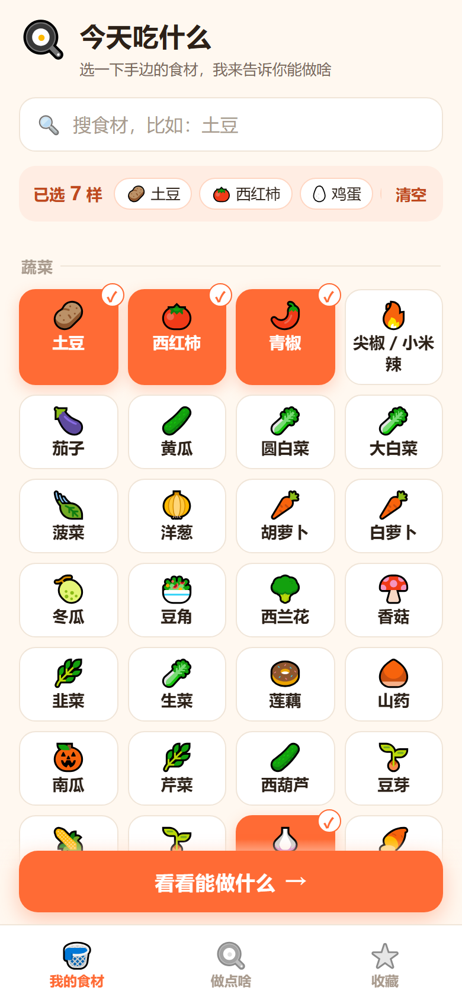
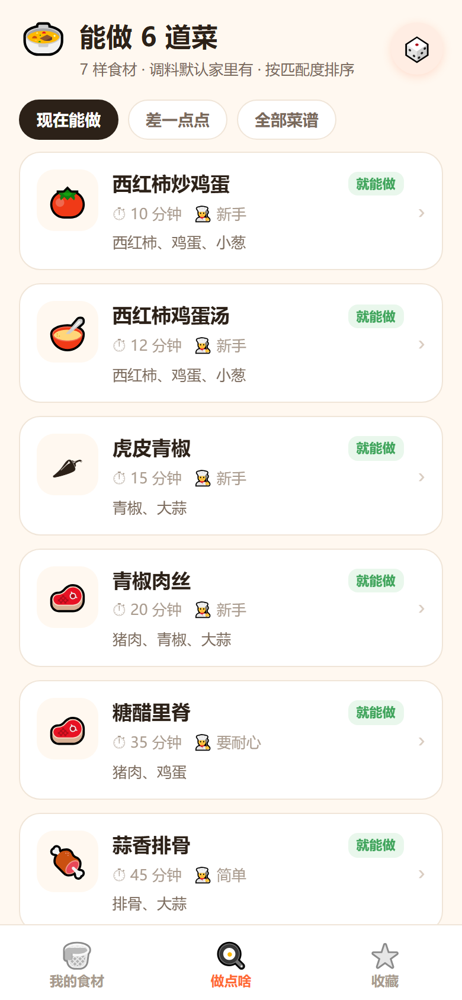
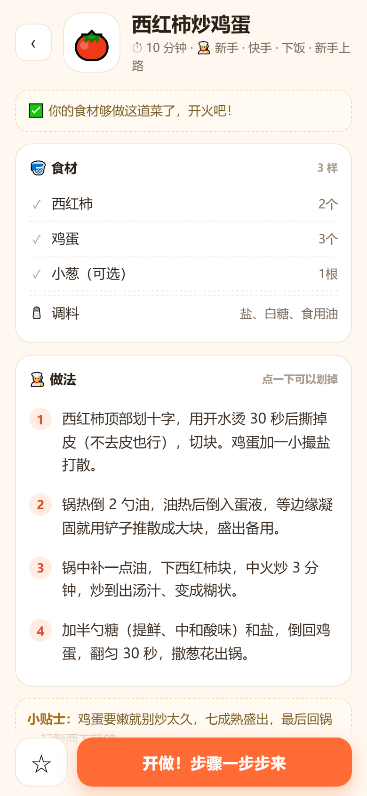
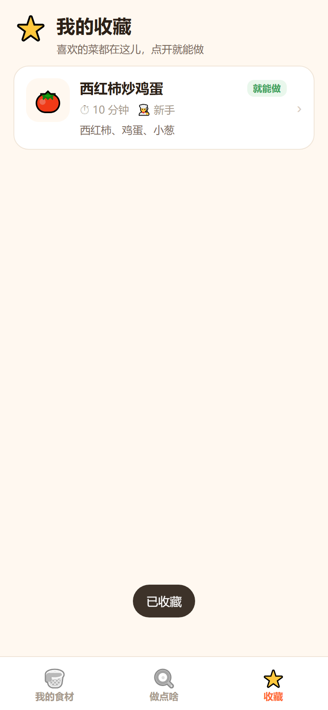

# 今天吃什么 🍳

一个**简单易上手**的做菜 App：打开它 → 勾一下冰箱里现有的食材 → 它马上告诉你现在就能做哪些菜，并手把手教你怎么做。

> Android 安装包：[`dist/今天吃什么.apk`](dist/今天吃什么.apk)（约 62KB，离线可用，仅需联网权限访问参考菜谱网站）

## 📸 界面预览

| ① 勾选手边食材 | ② 马上知道能做什么 |
| :---: | :---: |
|  |  |
| **③ 一步步教你怎么做** | **④ 收藏常做的菜** |
|  |  |

## ✨ 功能

| 功能 | 说明 |
| --- | --- |
| 🧺 我的食材 | 按分类勾选 50+ 种常用食材，搜索快速定位，选择自动保存 |
| 🍳 做点啥 | 按「食材匹配度」排序：现在就能做 / 差一点点 / 全部，还差什么一目了然 |
| 🎲 随便来一道 | 选择困难症救星，一键帮你决定今天吃什么 |
| 📖 菜谱详情 | 用量清单（有✓/缺✕）、分步做法（新手向、含火候和时间）、小贴士 |
| ⭐ 收藏 | 喜欢的菜存起来，下次直接做 |
| 🔗 更多做法 | 每道菜可跳转下厨房 / 香哈 / 美食天下查看图文详情 |

- **53 道精选家常菜**：素菜、荤菜、水产、汤、主食、凉菜
- **完全离线**：菜谱数据内置，选食材、看做法不费流量
- **调料默认家里有**：只勾食材就行，不用被「盐、生抽」刷屏

## 📱 安装

**直接下载**：[`jintian-chi-shenme-v1.0.apk`](https://github.com/rockyanyan/jintian-chi-shenme/releases/download/v1.0/jintian-chi-shenme-v1.0.apk) （在 [Releases](https://github.com/rockyanyan/jintian-chi-shenme/releases) 页也能找到）

也可以把仓库里的 `dist/今天吃什么.apk` 传到手机上安装（需允许安装未知来源应用）。支持 Android 5.0+。

## 🛠 技术方案

- 前端：纯 HTML/CSS/JS 单页应用（无框架、无依赖），数据在 `app/js/data.js`
- 壳：原生 Android WebView（`android/src/.../MainActivity.java`），站外链接自动交给系统浏览器
- 打包：不依赖 Gradle / Android Studio，纯命令行
  `aapt2 → javac → d8 → zipalign → apksigner`，一条脚本完成：

```bash
bash scripts/build-apk.sh
```

构建参数（工具路径）见脚本头部注释。签名密钥在 `android/release.keystore`（演示用途，正式发布请更换并妥善保管）。

## 📂 目录结构

```
├── app/               # Web 前端源码（index.html / css / js）
├── android/           # Android 壳工程（Manifest / res / src / 签名）
├── scripts/           # 一键打包脚本
├── dist/              # 打包产物 APK
└── 源网站/            # 项目参考的菜谱网站来源
```

## 🙏 灵感与参考

菜谱内容为整理编写的本地版本，更多图文/视频做法请参考：[下厨房](https://www.xiachufang.com/) ·
[香哈菜谱](https://www.xiangha.com/) · [美食天下](https://home.meishichina.com/recipe.html) ·
[大厨网](https://www.dachu.co/zh-hans/dish) · [网上厨房](https://www.xiaochushuo.com/) ·
[食用手册](https://cook.yunyoujun.cn/)
